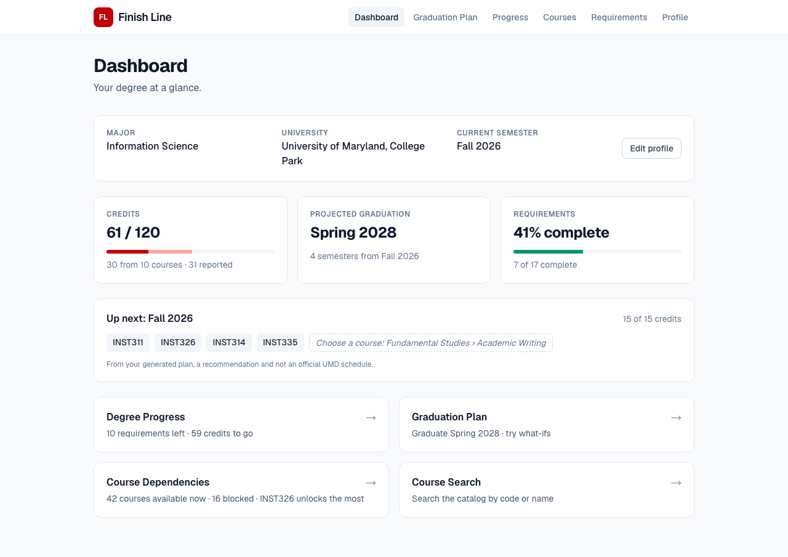
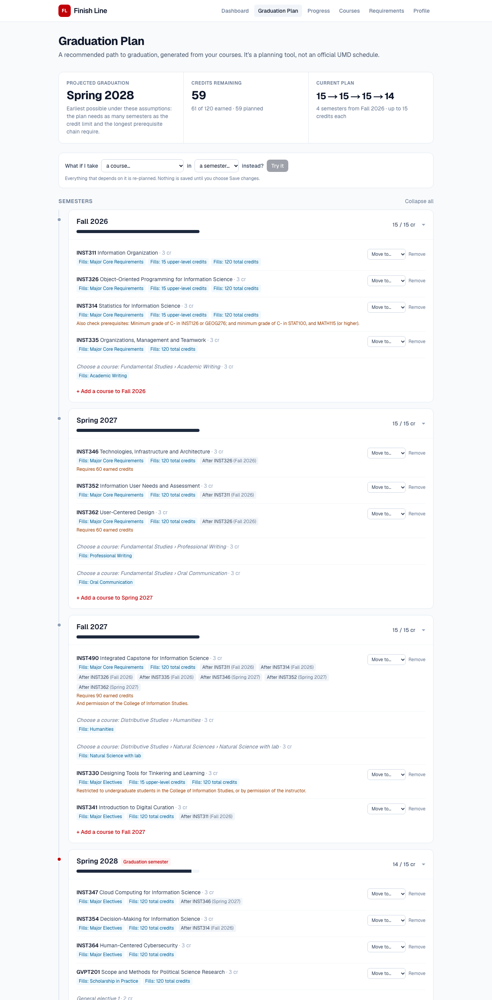
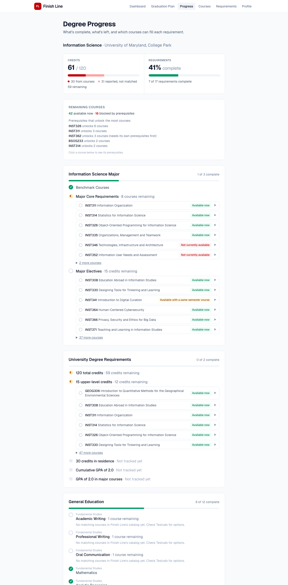
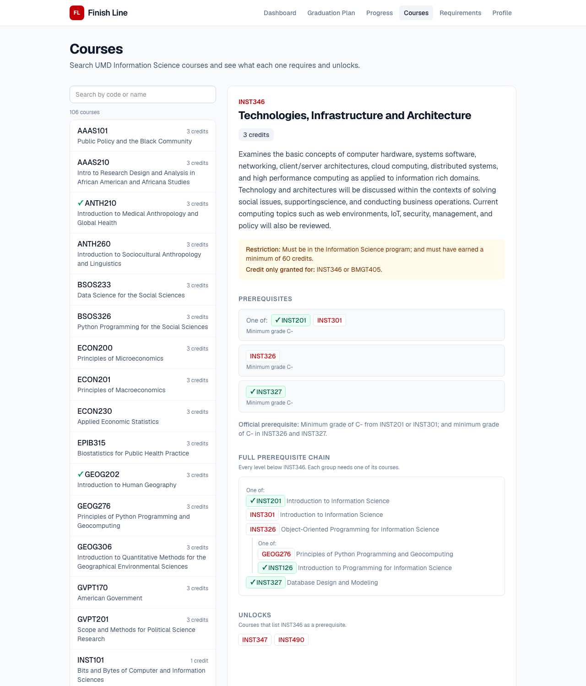

# Finish Line

*Your degree. Your plan. Your finish line.*

**A degree planner for UMD students, starting with Information Science.** Enter the courses you've completed. Finish Line shows which degree requirements are done, what's left, which courses you can take next, and a semester-by-semester path to the earliest graduation, which you can rearrange with what-ifs.

> **Finish Line is a planning tool, not an official UMD degree audit.** Its data comes from the public UMD catalog and Schedule of Classes, and every generated plan is a recommendation. Students should confirm plans with an academic advisor.



| Graduation plan | Degree progress | Course dependencies |
| --- | --- | --- |
|  |  |  |

---

## Features

- **Dashboard:** the student's program, credits that count toward 120 (plus in-progress and unverified credit, shown separately), projected graduation, requirement completion, next semester's courses, and links to every tool.
- **Degree progress:** every university, General Education, and major requirement, marked complete, in progress, not started, or not tracked yet. Each remaining requirement lists the courses that can still fill it, with their prerequisite status.
- **Prerequisites and dependencies:** for any course, whether the student can take it now, which prerequisites are missing, the full prerequisite chain, and which courses it unlocks.
- **Academic history:** semesters at UMD and at other schools, courses in progress, transfer credit (with or without a UMD equivalent, or credit that doesn't map to one course), Gen Ed or other requirements met another way (transfer evaluation, exam, waiver, substitution, associate degree), academic standing, and expected graduation. Every item is marked reported by the student, verified by UMD, or an approved exception, and only verified or approved items count. Students don't have to have started at UMD.
- **Your own semester plan:** past semesters show as history, the current one as in progress, and the future plan starts at the semester the student chooses (Fall, Spring, or Summer). Add, move, and remove courses in any of them. Credits per semester and in total come from the saved plan. Every change is checked against prerequisites, the credit limit, credit-standing restrictions, and degree requirements, and problems show as warnings.
- **Optional recommendations:** generate a recommended plan built around the courses you've already planned and your academic history. It respects prerequisites, the credit limits (including a separate Summer limit), restrictions such as "must have earned 90 credits", recent Testudo offering seasons, and your target graduation. Each course says why it's recommended and what couldn't be verified. Nothing is added until you accept it, and accepted courses stay editable.
- **Majors:** choose from the 103 College Park majors in the catalog. Information Science and Technology and Information Design have verified requirements; for the others Finish Line says so and doesn't make up a plan. Switching majors keeps completed and planned courses and rechecks them.
- **Course search:** the full UMD undergraduate catalog (5,457 courses in 202 departments), by code, name, or department. Each course shows its Gen Ed tags, restrictions, and prerequisites, plus how far each detail is verified.
- **Light and dark mode:** a sun/moon toggle in the header. The first visit follows the operating system; a choice made with the toggle is remembered in the browser. Colors are defined once in `frontend/src/app/globals.css` (see the comment there for how the palette roles work in each theme).
- **No accounts:** a student's profile is a planning session stored in PostgreSQL and remembered by the browser.

## Technology

| Layer | Stack |
| --- | --- |
| Frontend | Next.js 16 (App Router), React 19, TypeScript, Tailwind CSS 4 |
| Backend | Python 3.13, FastAPI, Pydantic, psycopg 3 with a connection pool |
| Database | PostgreSQL 17 |
| Tests | pytest (161 tests) and Playwright browser tests: pure unit tests of the engines and parsers, plus API tests against the migrated database |

## Architecture

```
 Browser (Next.js / React)
 ─────────────────────────────────────────────────────────────────────
  Dashboard · Graduation Plan · Degree Progress · Courses · Profile
  Display and editing only. No degree or prerequisite logic lives here.
                               │
                               │  JSON over HTTP (lib/api.ts)
                               ▼
 FastAPI (backend/app)
 ─────────────────────────────────────────────────────────────────────
  Routes      courses · requirements · sessions · degree_progress
              eligibility · graduation_plan · dashboard
                               │
  Services    evaluator.py      requirement rules  → completion status
  (pure       prerequisites.py  prerequisite graph → eligibility, chains
   Python)    planner.py        choose courses → topological schedule
              restrictions.py   program limits, credit overlaps, standing
                               │
                               │  SQL (psycopg pool)
                               ▼
 PostgreSQL
 ─────────────────────────────────────────────────────────────────────
  Catalog      departments · courses · prerequisite_groups · prerequisite_options
               course_gen_ed · course_restrictions · course_exclusions
  Degree       universities · programs · requirements
               requirement_courses · requirement_course_filters
  Students     planning_sessions · session_courses · planned_courses
                               ▲
                               │  generated seed.sql
 database/build_seed.py ── validates ── database/data/*.json (curated from the UMD catalog)
```

Design principles:

- **Degree logic lives in the database.** Requirements, prerequisites and restrictions are rows. The Python engines evaluate whatever rules they're given; there is no `if course == "INST201"` anywhere. Adding a program means adding data.
- **Engines are pure functions.** `evaluator`, `prerequisites` and `planner` take plain data and return plain data. Routes load from the database and hand it over, so the logic is unit-tested on small made-up degrees.
- **The frontend only displays.** It never decides whether a requirement is met or a course is available. It asks the API.

## Project structure

```
backend/
  app/
    main.py              app setup, CORS, database-outage handler (503)
    db.py, config.py     connection pool, settings from .env
    courses.py           course search, detail, prerequisites, dependents, prerequisite tree
    requirements.py      programs, requirement tree, progress for a course list
    sessions.py          planning session (profile + completed courses)
    degree_progress.py   completed / remaining requirements for a session
    eligibility.py       available vs. blocked remaining courses
    graduation_plan.py   the student's saved plan (add/move/remove), recommendations
    dashboard.py         one-call dashboard summary
    evaluator.py         requirement rule engine          (pure)
    prerequisites.py     prerequisite graph and checks    (pure)
    planner.py           course selection and scheduling  (pure)
    restrictions.py      enrollment rules                 (pure)
  tests/                 pytest suite
database/
  migrations/            schema migrations (001 initial, 002 multi-department catalog, 003 student plans + majors)
  migrate.py             applies migrations, then syncs data (preserves student records)
  importer/              fetch_catalog.py (official catalog + Testudo), rules.py (strict parsers)
  data/catalog/          imported catalog: courses, departments, Gen Ed tags
  data/*.json            hand-curated INST prerequisites/restrictions, degree requirements
  build_seed.py          validates the data and generates seed.sql
  seed.sql               generated, idempotent data sync
frontend/
  src/app/               pages: /, /dashboard, /graduation-plan, /progress, /courses, /requirements, /profile
  src/components/        page components; plan/ (timeline), ui/ (states, progress bar)
  src/lib/               API client, session storage, shared hooks
docs/screenshots/
```

## Database design

```
universities ─┬─< departments
              ├─< programs ─────< planning_sessions ─┬─< academic_terms (UMD or another school)
              │                                       ├─< session_courses >── courses  (completed / in progress)
              │                                       ├─< transfer_credits >── courses (optional equivalent)
              │                                       ├─< requirement_fulfillments (verified or approved)
              │                                       └─< planned_courses >── courses
              ├─< courses ─┬─< course_offerings >── offering_terms (Testudo terms checked)
              │            ├─< prerequisite_groups ─< prerequisite_options >── courses
              │            ├─< course_gen_ed
              │            ├── course_restrictions
              │            └─< course_exclusions >── courses
              └─< requirements (tree via parent_id; also owned by programs)
                     ├─< requirement_courses >── courses
                     └─< requirement_course_filters
```

**Prerequisites** are *groups of alternatives*. Every group must be met, and any one option meets a group:

```
INST346  =  (INST201 or INST301)  AND  (INST326)  AND  (INST327)
            └──── group 1 ───────┘    └ group 2 ┘    └ group 3 ┘
```

Each group also stores a minimum grade (e.g. C-) and a timing: completed before, before or in the same semester, or a corequisite taken in the same semester.

**Requirements** form a tree. Each node has a `rule`:

| Rule | Meaning | Example |
| --- | --- | --- |
| `all_courses` | every listed course | Major core (10 courses) |
| `min_courses` | N courses from a set | Gen Ed Humanities: 2 courses tagged DSHU |
| `min_credits` | N credits from a set | Major electives: 15 credits of INST 300–499 |
| `all_children` / `any_child` | all / one of the child requirements | Diversity: 2 UPS courses, or 1 UPS + 1 Cultural Competence |
| `course_list` | a list with no stated count (shown, not scored) | Some cognate areas |
| `not_tracked` | can't be checked from a course list | GPA, residency |

A requirement's courses come either from an explicit list (`requirement_courses`) or from patterns (`requirement_course_filters`: subject, number range, Gen Ed tag). An **allocation group** controls double counting: inside one group a course counts once (a core course isn't also an elective), but across groups it can count again where UMD allows it (INST201 counts for the major core *and* Gen Ed).

**Restrictions** are structured from the catalog text: minimum earned credits (INST490: 90), allowed programs, "credit only granted for" pairs (INST201/INST301), and "can't take after" (INST123 after INST327).

## How the engines work

### Requirement evaluation (`evaluator.py`)

The evaluator walks the requirement tree, assigning the student's courses to leaf requirements:
- **Grade minimums:** a course only counts where it meets the requirement's minimum grade.
- **Allocation groups:** within a group, a course counts toward one requirement only.
- **Least flexible first:** the courses that fit the fewest requirements are assigned first, so a course that could fill several isn't used up where another would do.
- **"One of" requirements:** each option is tried on its own copy of the assignments, and the best one is kept.

### Prerequisites (`prerequisites.py`)

For each course and student, the prerequisite service returns:
- **Status:** available, available with a same-semester course, blocked, or completed.
- **Each group's state:** met, can be met in the same semester, or missing.
- **What to complete first:** an ordered list, worked out recursively. Where a group allows alternatives, it picks the option that needs the fewest extra courses (memoized, with a guard against circular prerequisites).

### Scheduling (`planner.py`)

The planner works in two phases.

**1. Choose courses (what to take)**
- **Required courses first:** every course on an "all of these" list.
- **Then each remaining requirement, in degree order:** it picks one course, preferring one that also fills other remaining requirements, then the fewest extra prerequisites, then fixed-credit courses.
- **Re-evaluate after every pick,** so a course that fills two requirements isn't doubled up.
- **Add prerequisite chains.** Courses the student can't take (other programs, credit overlaps, permission-only) are skipped.
- **Fill the gaps:** a requirement with no suitable catalog course gets a labeled "Choose a course" slot, and general-elective slots close any gap to 120 credits.

**2. Schedule (when to take it)**
- **Build a directed graph:** chosen courses are nodes, and each unmet prerequisite group adds an edge from one planned option to the course.
- **Topological sort:** Kahn's algorithm orders the graph and detects cycles.
- **Critical path:** each course gets a priority equal to the length of the longest chain that starts at it.
- **List scheduling:** each Fall and Spring (and Summer, if the student includes it) takes ready courses up to the credit limit, longest chain first and then required before elective. A course is ready when its "before" prerequisites are in earlier terms, its same-semester prerequisites are in this term or earlier, the student has the earned credits its restriction needs, and (when offering history exists) the course had sections in that season recently.
- **Earliest graduation:** the plan is compared with a lower bound, `max(⌈credits ÷ limit⌉, longest chain)`. When they match, the date is reported as the earliest possible under the stated assumptions. Otherwise the note explains the delay, e.g. credit standing.

**One student record.** `student_record.py` decides what counts, and the degree audit, plan, recommendations, eligibility, and dashboard all use it:
- Completed UMD courses count (an F earns no credit). In-progress courses don't count yet, but plans treat them as done by the next semester.
- Transfer credit verified by UMD counts: as the UMD course when an equivalent is recorded, otherwise toward total credits only. A transfer that duplicates a UMD course counts once.
- Student-reported transfer credit, reported fulfillments, and a reported credit total that isn't recorded as courses are shown as pending, never counted.
- A requirement met by a verified fulfillment (e.g. Gen Ed through an associate degree) is complete along with everything under it, so nothing is counted twice.

**Timeline.** The current semester comes from the profile. The plan starts at the student's chosen semester, or the one after the current semester. Nothing about semesters is hard-coded: terms are compared as `year × 4 + season` (Winter, Spring, Summer, Fall).

**The student's plan comes first.** The planner only runs when the student asks for a recommendation:
- **Built around the student's plan:** courses already in it are fixed in their semesters, and the planner fills in around them.
- **Nothing saved automatically:** the result is shown for review, and accepting it adds exactly the courses shown to `planned_courses`. "Choose a course" slots are listed but never added.
- **Saved-plan view:** `GET /plan` is computed from the saved rows on every request. Semester credits and total planned credits are sums of those rows; a course is planned at most once, and a retake doesn't add credits twice.
- **Same validation as the scheduler:** prerequisite order, credit limit, credit standing, restrictions, and whether each course fills a requirement.

## Data sources and accuracy

Every course and requirement comes from an official UMD source, and each detail records how far it's verified.

| Data | Source | Coverage (2026–2027) |
| --- | --- | --- |
| Courses: code, title, credits, department, description, prerequisite and restriction wording, cross-listings, "formerly", repeat rules | Undergraduate Catalog, approved courses for every department | **5,457 courses, 202 departments** |
| Gen Ed tags | Testudo Schedule of Classes Gen Ed listings, Fall 2025 – Fall 2026 | **913 courses tagged**; the rest are marked `none_found` |
| Major requirements | Catalog, plus the InfoSci program site for elective rules and cognate lists | Information Science |
| Gen Ed and university rules | Catalog | All |

**Prerequisites** carry a `prerequisite_status`:

| Status | Courses | Meaning | Used by checks and the planner? |
| --- | --- | --- | --- |
| `curated` | 51 | INST prerequisites reviewed by hand | Yes |
| `parsed` | 1,064 | The whole catalog sentence matched a strict pattern ("X and Y", "Minimum grade of C- in X", "1 course … from (X, Y)", …) | Yes |
| `partial` | 364 | The course part parsed; the sentence also allows a non-course option ("or permission of instructor") | Course part only, with a warning |
| `unstructured` | 1,155 | Wording that can't be read reliably (placement, "two English courses", mixed and/or) | **No.** Shown as text, flagged "couldn't be verified" |
| `none` | 2,823 | No prerequisite listed | Yes |

**Verification rules:**
- **Prerequisites aren't guessed.** A sentence that only partly matches a pattern, that names a course outside the catalog, or that offers a course alternative after "; or" is kept as text (`database/importer/rules.py`, unit-tested).
- **Conditional Gen Ed tags are stored but not counted.** 18 tags such as "DSNL (if taken with BSCI180)" depend on a second course, which Finish Line can't check yet.
- **Testudo section variants aren't imported.** 125 codes like INST204S or PHYS171H aren't separate catalog courses.
- **Restrictions:** 114 are structured (62 hand-curated, 52 parsed: credit standing and "must not have completed"). The other 1,974 are kept as text, and the planner won't auto-pick those courses.
- **Credit overlaps:** "Credit only granted for" pairs are read from the catalog for every department.
- **Validation:** `build_seed.py` refuses to build if a curated prerequisite, restriction number, program name or course code isn't in the official text.

## API

| Method | Path | Purpose |
| --- | --- | --- |
| GET | `/api/health` | API and database status |
| GET | `/api/courses?search=&department=&limit=` | Search the catalog; codes starting with the search come first. Total in `X-Total-Count` |
| GET | `/api/courses/departments` | Departments and course counts |
| GET | `/api/courses/{code}` | Course detail: department, catalog details, Gen Ed (counted and conditional), restrictions, prerequisites, and verification status |
| GET | `/api/courses/{code}/prerequisites` | Prerequisite groups |
| GET | `/api/courses/{code}/prerequisite-tree` | Every level of prerequisites |
| GET | `/api/courses/{code}/dependents` | Courses it unlocks |
| GET | `/api/programs` | Majors, with whether their requirements are verified |
| GET | `/api/programs/{slug}/requirements` | Requirement tree with eligible courses |
| POST | `/api/programs/{slug}/progress` | Evaluate any course list (stateless) |
| POST | `/api/sessions` | Create a planning session |
| GET / PATCH / DELETE | `/api/sessions/{id}` | Profile: program, current semester, plan start, target graduation, standing, credit limits, Summer, reported credits |
| GET / POST | `/api/sessions/{id}/courses` | UMD courses (`status` completed or in_progress, optional `academic_term_id`) |
| PATCH / DELETE | `/api/sessions/{id}/courses/{code}` | Change grade, credits, status or semester, or remove |
| GET | `/api/sessions/{id}/history` | Semesters, courses, transfer credit, fulfillments, and what counts |
| POST / PATCH / DELETE | `/api/sessions/{id}/history/terms[/{id}]` | Semesters at UMD or another school |
| POST / PATCH / DELETE | `/api/sessions/{id}/transfer-credits[/{id}]` | Transfer, exam, or other credit |
| POST / PATCH / DELETE | `/api/sessions/{id}/fulfillments[/{id}]` | Requirements met another way |
| GET | `/api/sessions/{id}/summary` | Dashboard summary |
| GET | `/api/sessions/{id}/progress` | Completed / remaining requirements and credits |
| GET | `/api/sessions/{id}/eligibility` | Available vs. blocked remaining courses |
| GET | `/api/sessions/{id}/eligibility/{code}` | One course's prerequisite status |
| GET / DELETE | `/api/sessions/{id}/plan` | The saved plan with credits, warnings, and requirements still needed; or clear it |
| POST | `/api/sessions/{id}/plan/courses` | Add a course to a semester (`code`, `term`, optional `credits`) |
| PATCH / DELETE | `/api/sessions/{id}/plan/courses/{code}` | Move a course or change its credits, or remove it |
| POST | `/api/sessions/{id}/plan/recommendation` | A recommended plan around the saved courses, not saved |
| POST | `/api/sessions/{id}/plan/recommendation/accept` | Add the reviewed courses to the plan |

Interactive docs: http://localhost:8000/docs. Errors use FastAPI's `{"detail": "..."}` shape. The API returns 404 for unknown courses or sessions, 409 for conflicts, 422 for invalid input, and 503 when the database is down.

## Running locally

**Prerequisites:** Node.js 20+, Python 3.11+, PostgreSQL 15+. On macOS: `brew install postgresql@17 && brew services start postgresql@17`.

```bash
# 1. Backend dependencies
cd backend
python3 -m venv .venv && source .venv/bin/activate
pip install -r requirements-dev.txt
cp .env.example .env              # DATABASE_URL, CORS_ORIGINS
cd ..

# 2. Database: create it, then apply migrations and sync the catalog
createdb finish_line
backend/.venv/bin/python database/migrate.py

# 3. Backend → http://localhost:8000
cd backend && uvicorn app.main:app --reload --port 8000

# 4. Frontend → http://localhost:3000
cd frontend
npm install
cp .env.example .env.local        # NEXT_PUBLIC_API_URL
npm run dev
```

Open http://localhost:3000, choose **Start Planning**, add a few completed courses, then open the **Dashboard** and the **Graduation Plan**.

**Updating data safely.** `migrate.py` is safe to run any time:
- **Migrations:** it applies any new migrations once each.
- **Courses:** updated by code. They're never deleted, so student records and course IDs survive, and a course that drops out of the catalog is only marked `in_current_catalog = false`.
- **Derived tables:** prerequisites, Gen Ed tags, restrictions and requirement mappings are rebuilt.

To refresh from UMD's sites, or after editing `database/data/*.json`:

```bash
backend/.venv/bin/python database/importer/fetch_catalog.py   # re-download catalog + Gen Ed (optional)
python3 database/build_seed.py                                  # validate and generate seed.sql
backend/.venv/bin/python database/migrate.py                    # apply
```

### Tests

```bash
cd backend && pytest
```

The suite has 179 tests. The engine tests use small made-up degrees, and the API tests run against the seeded database.

| Area | Where |
| --- | --- |
| Requirement completion, grade minimums, double counting | `test_evaluator.py`, `test_degree_progress.py` |
| Missing requirements and course suggestions | `test_degree_progress.py`, `test_requirements_api.py` |
| Prerequisites: none, one, several, alternatives, corequisites, cycles | `test_prerequisites.py` |
| Multi-level dependency chains | `test_prerequisites.py`, `test_planner.py` |
| Credit limits (several limits, oversized courses, pins over the limit) | `test_planner.py` |
| Schedule generation and recommendations | `test_planner.py` |
| Saved plan: add/move/remove credits, duplicates, prerequisite order, reload, switching majors | `test_student_plan.py` |
| Earliest graduation (credit-bound, chain-bound, standing-delayed) | `test_planner.py` |
| Sessions, dashboard, search, 503 handling | `test_sessions_api.py`, `test_dashboard.py`, `test_api.py` |
| Catalog parsers: what is structured, what is left as text | `test_catalog_rules.py` |
| Academic history: first-year, transfer with Gen Ed verified, partial transfer, several schools, in-progress courses, unmapped credit, plan starts in Fall/Spring/Summer, target graduation, Summer offering warnings | `test_academic_history.py` |
| Season- and offering-aware scheduling, verified fulfillments | `test_planner.py` |
| Planning with INST + non-INST courses; only verified data counts; sync preserves students | `test_multi_department.py` |

Browser tests drive the real UI in Chrome: switching majors, building a plan, adding, moving and removing courses with credit checks, reloading, duplicates, prerequisite warnings, recommendations, recording semesters at two schools, verifying transfer credit and Gen Ed, in-progress courses on the timeline, choosing the plan's first semester (including Summer), target graduation, and the theme (system default, toggle, persistence, no flash, keyboard). Set `E2E_WEB_URL` and `E2E_API_URL` to test other running servers. They start the backend and frontend themselves, or reuse running ones:

```bash
cd frontend && npm run test:e2e
```

## Known limitations

- **Majors:** all 103 College Park majors can be selected, but only Information Science and Technology and Information Design have verified requirements. Others show university and Gen Ed progress only.
- **Offerings are recent history, not a schedule.** Offering seasons come from Testudo sections in Fall 2025 – Fall 2026 (`fetch_catalog.py --offerings`). A course without recent sections is flagged, not assumed unavailable, and seats and times aren't known. Winter terms can be recorded in history but aren't planned.
- **Transfer equivalencies aren't looked up.** Finish Line has no access to UMD's transfer credit database; students enter equivalents and mark them verified themselves. "Verified" means the student says UMD has evaluated it.
- **Unverified data:** 1,155 courses have prerequisites that are only available as text, and 1,974 restrictions are text only. These are shown but not checked; the planner avoids them where it can and flags them where it can't.
- **Gen Ed coverage:** tags come from five recent terms. A course approved for Gen Ed but not offered in those terms shows `none_found` and doesn't count. Conditional lab tags aren't counted yet.
- **Not checked:** GPA, residency, permissions, and "or higher" math prerequisites are shown but not enforced.
- **Greedy, not optimal:** course choice is greedy. The schedule's length is checked against a lower bound, but the planner isn't an optimal solver.
- **No accounts:** anyone holding a session ID can edit that plan, and sessions don't expire. There's no rate limiting.

## Future improvements

- **Longer offering history:** import more past Testudo terms, and Winter planning.
- **Older catalog years:** import past catalogs so students can follow the requirements of the year they entered.
- **More structured prerequisites:** review the 1,155 text-only prerequisites (starting with Gen Ed courses), and model placement and "if taken with" conditions.
- **Accounts:** sign-in so plans persist across devices, with session expiry and rate limiting.
- **More programs:** start with the other College of Information majors, using the same tables.
- **Smarter optimization:** an ILP/CP-SAT formulation, so "earliest graduation" is provably optimal and can balance workload or preferred courses.
- **Advisor sharing:** read-only links to send a plan to an advisor.
- **CI:** GitHub Actions running pytest against a PostgreSQL service container, plus frontend lint and build.
